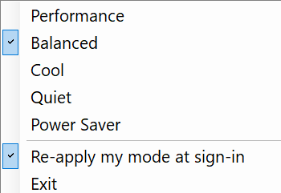

# Quick Mode Switcher

**A system-tray mode switcher for HP laptops.** Switch between Performance, Balanced, Cool, Quiet and Power Saver in two clicks, without opening myHP.

Made for the **HP Spectre x360 14 (2024, 14-eu0000 series, Intel Core Ultra)**. Other HP laptops may work; see [Other HP laptops](#other-hp-laptops). This is an independent project, not made by or affiliated with HP.

## Modes

Each mode is a setting in the laptop's BIOS that controls fan speed and CPU performance together. They're the same modes myHP offers, and the descriptions below follow myHP's.

| Icon | Mode | What it does |
|:---:|---|---|
| <br>P&nbsp;(red) | Performance | Raises fan speed so the CPU can work harder, for demanding software. Fans get louder and the laptop may run warmer. |
| <br>B&nbsp;(gray) | Balanced | Balances fan speed, performance and temperature. |
| <br>C&nbsp;(blue) | Cool | Raises fan speed and lowers CPU performance to cool the laptop. Useful when it feels warm to the touch. |
| <br>Q&nbsp;(violet) | Quiet | Keeps the fans at minimum speed and lowers CPU performance. Useful in quiet places. |
| <br>S&nbsp;(green) | Power Saver | Limits CPU performance to save power and extend battery life. In myHP, this mode can also turn on OLED screen power saving; this app doesn't. |

## Using it

Left- or right-click the tray icon to open the menu:



- **The five modes.** The checkmark shows the current one. The mode you pick here is *your mode*, and the app keeps the laptop on it.
- **Re-apply my mode at sign-in.** On by default: after a restart, the app switches back to your mode a few seconds after you sign in. Turn it off to keep whatever mode the laptop starts in.
- **Exit.** Closes the app. If it's installed, it starts again the next time you sign in.

What to expect:

| When you... | What happens |
|---|---|
| Pick a mode in the menu | The laptop switches right away and the icon changes. |
| Plug in or unplug the charger | Nothing, unless myHP is installed. Then you'll see myHP's mode for about 7 seconds before the app switches back. [Why?](#if-you-keep-myhp) |
| Wake the laptop from sleep | It stays on your mode. If anything changes it, the app switches back within about 7 seconds. |
| Restart and sign in | The laptop starts up in its startup mode, which is myHP's setting if myHP is installed. A few seconds after you sign in, the app switches to your mode. If "Re-apply my mode at sign-in" is off, the startup mode becomes your mode instead. |
| Pick a mode in myHP | It works, but only until the next plug-in, unplug, wake or restart. Then the app switches back to your mode. |

If a switch doesn't take, the app shows a notification. If the laptop's reply ever looks unfamiliar, for example after a BIOS update, it stops switching and the icon turns into an amber .

## Requirements

- The laptop above, or another HP laptop that passes the checks in [Other HP laptops](#other-hp-laptops)
- Windows 11 with Windows PowerShell 5.1, which is built in (Windows 10 is untested)
- A Windows administrator account: changing the mode needs admin rights, so the app runs with them

## Other HP laptops

Check yours before installing, by running these from the downloaded folder in this order (they're described under [Tools](#tools)):

1. `Test-Compatibility.ps1` says whether the BIOS supports the mode command.
2. `Get-ModeValues.ps1` checks that each mode in myHP uses the value this app expects.
3. `Test-ModeSwitch.ps1` changes the mode once and switches back, asking before each step.

This app won't work on Omen and Victus laptops, which use different values. Other tools cover those models.

## Install

1. Go to [Releases](../../releases/latest) and download **QuickModeSwitcher-*version*.zip** from the latest release.
2. Right-click the downloaded file and choose **Extract All**.
3. In the extracted folder, double-click **Install.cmd** and approve the administrator prompt. If Windows warns that the file came from the internet, choose **Run** (or **More info → Run anyway**).
4. A window shows what the installer did. Press Enter to close it.

The installer:

- checks that your laptop answers the mode command, and asks before going on if it doesn't
- copies the app to `C:\Program Files\QuickModeSwitcher`
- creates a scheduled task, "Quick Mode Switcher", that starts it with admin rights whenever you sign in, without an admin prompt
- adds the app to Windows' Installed apps, so you can uninstall it from Settings
- starts it

The icon may land in the taskbar's `^` overflow area; drag it onto the taskbar to keep it visible.

If you'd rather use the command line, run `powershell -ExecutionPolicy Bypass -File .\Install-QuickModeSwitcher.ps1` from the folder instead.

After installing, you can delete the downloaded folder. Everything the app needs, including its uninstaller, is in `C:\Program Files\QuickModeSwitcher`. Keep the folder only if you want the scripts in `tools/`.

**To try it without installing,** right-click the Start button, choose **Terminal (Admin)**, and run these, using the folder you extracted (the version number in its name will match the one you downloaded). It runs until you choose Exit, and doesn't start again on its own.

```
cd "$env:USERPROFILE\Downloads\QuickModeSwitcher-0.1.0"
powershell -ExecutionPolicy Bypass -File .\QuickModeSwitcher.ps1
```

**To update,** download the zip from the newest release, extract it and double-click its **Install.cmd**. It stops the running copy, replaces it and keeps your settings. Settings → Apps → Installed apps shows which version you have.

**To uninstall,** go to Settings → Apps → Installed apps → **Quick Mode Switcher** → Uninstall, or double-click **Uninstall.cmd** in the downloaded folder. Either one stops the app and removes it, its scheduled task, its Installed apps entry and its settings, then tells you if anything couldn't be removed. The laptop stays in whatever mode it's in, and your downloaded folder isn't touched.

## If you keep myHP

myHP doesn't have to go, but it does interfere a little. Its background process, `HP.SystemControl.Background.exe`, puts back myHP's own setting every time you plug in or unplug, several times over about 5 seconds. This app waits for it to finish, then switches back to your mode once; switching back sooner just starts a back-and-forth.

**Set myHP to the mode you want the laptop to start in.** The laptop starts up in myHP's setting, and that's the mode you'll see for a few seconds after plugging in or unplugging. Balanced is a sensible choice. Picking modes in this app doesn't change myHP's setting.

To remove myHP instead:

1. Settings → Apps → Installed apps → **myHP** → Uninstall. (HP is replacing myHP with a newer app called just **HP**; if that's what you have, this app hasn't been tested with it.)
2. Search Start for **Change device installation settings** and choose **No**. HP delivers myHP through driver packages from Windows Update, and this setting should keep it from being reinstalled automatically.

If myHP comes back anyway, this app keeps working; you'll just see the brief switch again. To watch it happen, run `Watch-PlugUnplug.ps1` (see [Tools](#tools)).

## Troubleshooting

- **No icon after installing.** Check the taskbar's `^` overflow area. If it isn't there, run `QuickModeSwitcher.ps1` directly from an Administrator PowerShell to see any error, or look at the "Quick Mode Switcher" task in Task Scheduler.
- **Nothing happens when I run `QuickModeSwitcher.ps1`.** It's already running, probably the installed copy; look for its icon.
- **The icon is an amber `!`.** The laptop's reply wasn't what the app expects, for example after a BIOS update, so switching is off. Run `Test-Compatibility.ps1` and `Get-ModeValues.ps1` to see what changed.
- **The mode changes on its own.** That's myHP (see [If you keep myHP](#if-you-keep-myhp)). On other models it may be a different HP program; `Find-ModeChanger.ps1` finds it.
- **An old icon stays in the tray after updating or uninstalling.** Windows removes it as soon as you move the mouse over it.
- **Settings** are in `settings.json` next to the app, which is `C:\Program Files\QuickModeSwitcher` when installed.

## Tools

Helper scripts in `tools/`, for checking compatibility and seeing what's going on. To run one, right-click the Start button, choose **Terminal (Admin)**, go to the extracted folder and run the script, for example:

```
cd "$env:USERPROFILE\Downloads\QuickModeSwitcher-0.1.0"
powershell -ExecutionPolicy Bypass -File .\tools\Test-Compatibility.ps1
```

Each copies its results to the clipboard when it finishes.

| Script | What it does | Changes anything? |
|---|---|---|
| `Test-Compatibility.ps1` | Shows the model and BIOS, whether the BIOS answers the mode command, and the HP software running with its memory use. | No |
| `Get-ModeValues.ps1` | You pick each mode in myHP and type its name; it checks the BIOS value against the [table below](#how-it-works-technical). Needs myHP. | No |
| `Test-ModeSwitch.ps1` | Re-sends the current mode, switches to another, then switches back. Asks before each step. | Yes, and switches back |
| `Watch-PlugUnplug.ps1` | Logs mode changes as you plug in and unplug, and how long the app takes to switch back. | No |
| `Find-ModeChanger.ps1` | Stops one HP app's programs at a time and watches plug/unplug, to find which one changes the mode. Asks before each app. | Stops programs until the next restart |

## How it works (technical)

The modes are a single BIOS setting exposed through HP's WMI interface (`root\wmi`, class `hpqBIntM`), command type `0x4C`. It's the same setting myHP changes, and the same command the Linux kernel's `hp-wmi` driver uses.

| Value | Mode |
|---|---|
| `00` | Performance |
| `01` | Balanced |
| `02` | Cool |
| `03` | Quiet |
| `04` | Power Saver |

- **Read:** `Command = 1`, method `hpqBIOSInt128`. The first byte of the reply is the mode; the second is a status flag that changes on its own and is ignored.
- **Write:** `Command = 2`, method `hpqBIOSInt0`, data `[mode] 00 00 00`.

Safety checks:

- It sends only those two commands, and only values `00`–`04`.
- It checks every reply (return code 0, signature `PASS`, mode `00`–`04`). If one looks wrong, switching turns off.
- It reads the mode back after each switch and warns if it didn't take.
- The installed copy lives in Program Files, so only admins can change the script that runs with admin rights.

## Limitations

- It sets the BIOS mode only. Anything myHP does on top of that, such as Smart Sense's automatic switching or Power Saver's OLED screen power saving, isn't replicated.
- Memory use is that of a PowerShell process, roughly 50–100 MB (about 60 MB on the Spectre it was made for).

## Credits

The command and mode values were documented by the Linux kernel's [`hp-wmi` driver](https://github.com/torvalds/linux/blob/master/drivers/platform/x86/hp/hp-wmi.c).

Not affiliated with or endorsed by HP. Use at your own risk.

## License

Copyright (C) 2026 cdecaro3. Licensed under the [GNU General Public License v3.0](LICENSE): you can use, change and share this, but anything you share that's based on it must stay open source under the same license.
